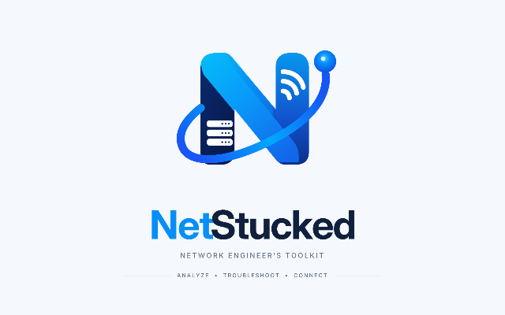

# NetStucked 0.7.0

Windows x64 network toolkit built with C# / WPF / .NET 10 / MVVM. [Download 0.7.0 — GitHub Latest](https://github.com/pk-wrk-sea/NetStucked/releases/tag/v0.7.0).



## Current tools

- Live Ping and continuous ICMP Traceroute with real network results, independent sessions and bounded probe scheduling.
- TCP-only Port Test with continuous multiple-target scanning, port ranges, saved templates and configurable TCP payloads.
- Subnet Cal: one field accepts IPv4/prefix, spaced CIDR or dotted subnet masks; calculates while typing and distinguishes incomplete input from syntax errors.
- DNS Resolver: selectable DNS records and servers, including NS/SOA, bounded lookups, cancellation and measured export.
- MAC Checker: actual MACVendors.com manufacturer lookup with bounded requests, rate limits, caching and cancellation. Vendor registration does not establish device identity.
- URL Checker: approved in-app results layout, explicitly unconfigured. Live VirusTotal/Palo Alto integration awaits provider accounts/keys and a supported Palo Alto API.

Version 0.7.0 removes Diagnostics, the old DNS and HTTP/HTTPS test screens, and the complete Network Info/Wi-Fi Manager desktop feature. Compatible saved settings and older published releases are preserved. Light/Dark/System themes, shared hop descriptions, selectable tables and explicit Updates & Recovery remain available. Dashboard and other future pages remain pending. See [approved scope and remaining gates](docs/TOOLS_REVISION_2026-10-15.md).

## Update or install

Open **Updates → Check for Updates → Install v0.7.0**. Installers are unsigned: acknowledge the hash-verified unsigned project installer and follow ordinary Windows UAC/SmartScreen prompts. Updates only check/install after an explicit user action.

The [release page](https://github.com/pk-wrk-sea/NetStucked/releases/tag/v0.7.0) also provides a self-contained Windows x64 portable ZIP, setup EXE, SHA-256 files and provenance manifests. Keep the portable directory together. The application includes its runtime; compiling the installer requires Inno Setup 6. Preferences/logs remain per-user under `%LOCALAPPDATA%\NetStucked`.

## Build and verify

Install a .NET 10 SDK, then run from the repository root:

```powershell
dotnet restore NetStucked.sln
dotnet build NetStucked.sln -c Release --no-restore
dotnet test tests/NetStucked.Tests -c Release --no-build
dotnet run --project tests/NetStucked.WindowsQa -c Release --no-build -- artifacts/windows-qa 0
pwsh -File scripts/Publish.ps1
```

The central version is in `Directory.Build.props`. Default self-contained output is `artifacts/publish/win-x64/NetStucked.exe`; release operations use fresh directories and immutable source tags/packages. Choose only targets you are authorized to diagnose. ICMP loss does not establish a remote service outage; no sample telemetry is used as production data.

## Release evidence and open acceptance

0.7.0: **315 tests passed**, actual WPF Light/Dark and exact portable DLL/native checks passed, a 60-second owned-loopback soak passed, and branch/PR/main/installer Windows workflows passed. The actual public 0.6.0 production checker finds **Install v0.7.0**. Public installer download/hash/Windows trust/helper preparation passed from both 0.6.0 and 0.7.0; Setup was not executed. See [source, hashes, CI and public updater evidence](docs/GITHUB_RELEASE_0.7.0_REPORT_2026-10-15.md).

**NOT TESTED:** clean-machine installation/upgrade/recovery/uninstall, physical DPI/mixed-monitor/accessibility, manual installed-UI acceptance, remote network matrices and long soak. URL provider integration and installer signing remain open. A published release does not close the full acceptance milestones.

## Product and historical records

[Milestones](docs/MILESTONE_INDEX.md), [implementation status](docs/IMPLEMENTATION_STATUS.md), [features](docs/FEATURE_REGISTRY.md), [next task](docs/CODEX_NEXT_TASK.md), [UI approvals](docs/UI_APPROVAL_REGISTER.md), [architecture](docs/ARCHITECTURE.md), [security/data policy](docs/SECURITY_AND_DATA_POLICY.md) and [release procedure](docs/RELEASE.md) distinguish approved implementation from future scope. Original references in `design/references/` remain unchanged.

Earlier releases remain available for explicit recovery: [0.6.0](https://github.com/pk-wrk-sea/NetStucked/releases/tag/v0.6.0), [0.5.0](https://github.com/pk-wrk-sea/NetStucked/releases/tag/v0.5.0), and earlier supported releases. Their feature/QA/publication reports describe those historical versions. The specifically authorized 0.2.x download retirement preserved Git source tags/history and verified local backups; it does not permit rewriting other published assets. See [release/version register](docs/RELEASE_AND_VERSIONING.md).
